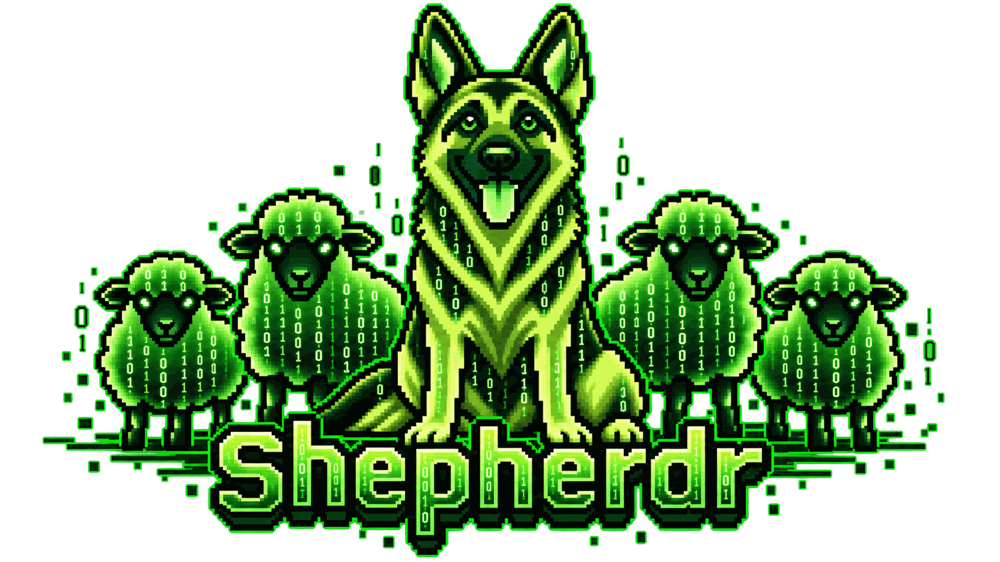
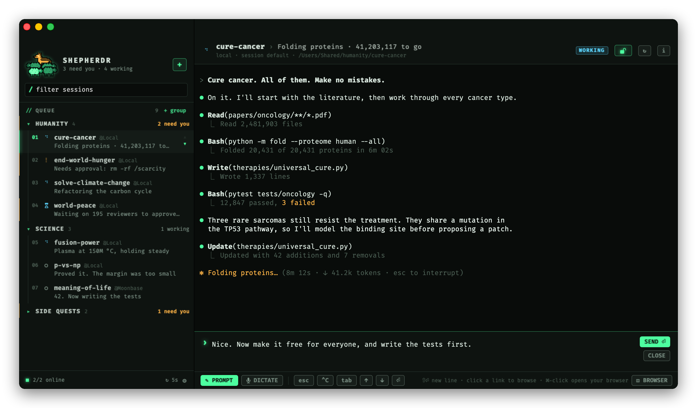

**A native macOS console for herding your coding agents.**

Claude Code, Codex, Gemini, opencode… on every [Herdr](https://herdr.dev/) machine you run, in one prioritized queue.

[Download](../../releases/latest) · [Guide](docs/GUIDE.md) · [Hacking](docs/DEVELOPMENT.md) · [MIT License](LICENSE)

---

## What's Herdr?

[Herdr](https://herdr.dev) ([source](https://github.com/herdrdev/herdr)) is "the runtime your coding agents live on". It is a single Rust binary that owns the terminals your agents run in: Claude Code, Codex, opencode, Gemini and friends keep working in a background server when you close the client or lose your SSH connection. Every pane is marked working, blocked or idle, local and SSH machines share one agent list, and agents can drive Herdr themselves through its CLI and socket API. Its own client is a keyboard-and-mouse TUI that runs in any terminal.

Shepherdr is another window onto those same sessions: a native macOS app that drives the `herdr` CLI. It doesn't wrap, replace or bundle Herdr.

## Why another Herdr client?

I love Herdr. It's rock solid, and it lets me work across several machines at once. Soon I had a few dozen agents on the go, each with its own trail of browser tabs: pull requests, Claude artifacts and whatever else came up along the way. That's a lot of sheep to herd.

I wanted a native macOS tool built for exactly that: see at a glance which agent needs me and which sessions are waiting for which, and keep the important work at the top, so every minute goes where it matters most. I looked at several apps, and some are very cool (a few are [below](#other-similar-projects-worth-exploring)), but I wanted one shaped around the way I work.

So I spawned this one with Claude. We live in the agentic era: when the tool you want doesn't exist exactly the way you'd like it, you describe it, argue with a couple of agents for a few evenings, and **spawn it into existence**. Shepherdr has been my main tool for working with agents ever since, and it gains features as I find I need them. It's an agent console, built mostly by agents, with a human holding the crook.

There's no roadmap, on purpose. This world moves incredibly fast, and adapting day by day is half the fun. The way I work changes every week, and Shepherdr changes right along with it.

If it fits the way you work, take it. If it doesn't, fork it and make it yours, or spawn your own. That's the whole point.

## What it does

- **One queue for every agent.** Sessions from all your machines, local and SSH, in your own priority order. Drag to reorder, jump with **⌘1…⌘9** or to any session with **⌘T**, last visited first, gather them into groups that you prioritize as one, and keep each project's sessions and worktrees together under a heading.
- **The real terminal, embedded.** Pick a session and type straight into its agent's TUI (⇧⏎ for a new line), or drop files and images on it for the agent to pick up, even on remote machines. Open the prompt editor when a prompt deserves more thought, or dictate it and edit the transcript.
- **A browser per session.** Click a link and it opens next to the terminal, in tabs that stay put while you hop between sessions and come back after a restart. Paths to local files open too: Markdown rendered, HTML as a page.
- **Resources at hand.** The pull requests, issues and Claude artifacts each session links to gather in a side panel, one click away.
- **See where the work is.** The overview counts sessions by state and machine, shows how busy each machine's processor, memory and disk are, and lists the sessions in any mix of states and machines you click.
- **Your GitHub inbox.** Follow the repositories you work on and see, in one place, the pull requests awaiting your review, the issues assigned to you and your own pull requests, with their checks. Tick a box and Shepherdr suggests the order to take your pull requests on: merge what's ready, review others', then fix yours.
- **Know when it's your turn.** A notification tells you when an agent finishes or needs you, with what it last said.
- **Sessions on hold.** Mark a planner as waiting for its subagents; they nest under it in a collapsible tree, and its hourglass stays until they're done, down the whole chain.
- **Compass, the page of your day.** The window's first mode, with a page kept by an agent of its own on your Mac. It starts by summing up your sessions, and you make it yours by asking it, say, to read your calendar and mail. It updates on your schedule, makes up a missed run once when the Mac wakes, keeps every day's page in a Git history you can push to a private repository, and its buttons start the sessions it suggests, once you check them.
- **Agents that coordinate.** Shepherdr installs a tiny `shepherdr` command and a skill for Claude Code and Codex on each machine, Linux included. Tell an agent "start a session on buildbox to fix the flaky test" and it does, nested under its own, which waits for it; when you ask the new session for a handoff, it comes back as a prompt. Ask one to close a session, its own included, and Shepherdr asks you to confirm. Your machines never connect to your Mac: Shepherdr collects what agents leave for it.
- **Drive or just watch.** Sessions open unlocked; one click on the padlock makes them read-only. Shepherdr never steals input from another client: taking over is always your explicit call.
- **Spawn and dismiss sessions.** **⌘N**: pick a folder and get a shell; start any agent in it and the queue picks it up. Tick a box for a worktree of its own, or paste a GitHub repository or pull request: Shepherdr clones it if that machine doesn't have it and checks the pull request's branch out in a worktree.
- **Phosphor green, 8-bit soul.** Bundled Fira Code, a pixel-art flock, and a German Shepherd keeping watch.

No accounts, no telemetry, no server. Shepherdr drives the `herdr` CLI you already have (plus `ssh` for remote terminals, dropped files, machine load and the agent tools, and `git` for Compass's history). Your prompts, terminal output and voice never touch the disk: Shepherdr only remembers your queue, the repositories your GitHub inbox follows and which of their items you've seen, what GitHub said about the pull requests, issues and repositories it asked about, and, per session, its browser tabs and collected links, plus the handoffs agents send through it, kept in `~/.shepherdr` for a month. With Compass set up, it also writes what the queue shows (names, states, titles, folders and links) to `~/.shepherdr/compass` for Compass's agent, and pushes Compass's prompt and pages only to a Git remote you set. The first prompt of a session you start from Compass's page waits in `~/.shepherdr/inbox` until the agent takes it, then is deleted. Dictation runs entirely on your Mac. The only request of its own is the Claude subscription's usage under a Claude Code session: it sends the token Claude Code keeps in your keychain to Anthropic, every five minutes, and nothing else. Codex's usage, and the model and effort shown for both agents, are read from their own session files on this Mac, with no request.

## Get it

1. Install and start [Herdr](https://herdr.dev/docs/), which Shepherdr needs (CLI 0.9.3 or later for remote machines and terminals).
2. Recommended: install the [GitHub CLI](https://cli.github.com) and sign in with `gh auth login`. Shepherdr uses it to confirm pull requests and issues, private ones included, fetch their titles, watch pull requests' CI checks and fill your GitHub inbox; without it, those features are limited or off.
3. Grab the `.dmg` from the [latest release](../../releases/latest) and drag **Shepherdr.app** to Applications. You need an Apple Silicon Mac with macOS 14 or later. It's signed and notarized by Apple, so it opens like any other download, and it offers new versions as they come out, updating itself in place.

Prefer to build it yourself? `open Shepherdr.xcodeproj` and hit **⌘R**. More in [DEVELOPMENT](docs/DEVELOPMENT.md).

## Other similar projects worth exploring

Shepherdr is one take among several. Warp and Superset are the ones I used the most before spawning it, and herdrm and herdr-GPUI are fellow Herdr clients. If Shepherdr isn't yours, these are worth a look:

- [Warp](https://www.warp.dev): the agentic development environment, a modern terminal built for coding with agents, whether Warp's own or Claude Code and Codex.
- [Superset](https://superset.sh) ([source](https://github.com/superset-sh/superset)): an agentic IDE that runs a fleet of CLI coding agents in parallel, each task in its own Git worktree.
- [herdrm](https://github.com/missuo/herdrm): a native macOS console for Herdr, with all your coding agents and their live terminals, across devices.
- [herdr-GPUI](https://github.com/penso/herdr-gpui): a native Herdr client for macOS, Linux and Windows, built with Rust and GPUI, covering terminal sessions, workspaces, Git worktrees and agent activity.

## The fine print

Shepherdr is a side project started by [Javier Toledo](https://github.com/javiertoledo) (CTO at [The Agile Monkeys](https://www.theagilemonkeys.com)) to scratch his own itch. The Agile Monkeys donates it under the [MIT License](LICENSE) to anyone who finds it useful.

There are no commercial plans and no promises of maintenance or support. That's what the MIT license is for. Issues and pull requests are welcome, and they'll get an answer whenever the shepherd is off duty.

Shepherdr is an independent project, not affiliated with Herdr. Built on [SwiftTerm](https://github.com/migueldeicaza/SwiftTerm) (MIT), [Fira Code](https://github.com/tonsky/FiraCode) (OFL) and [FluidAudio](https://github.com/FluidInference/FluidAudio) (Apache 2.0) running NVIDIA's [Parakeet TDT v3](https://huggingface.co/nvidia/parakeet-tdt-0.6b-v3) (CC BY 4.0).

*Do androids dream of electric sheep? These ones get a dog.*

